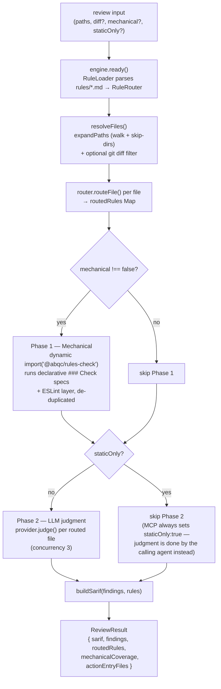
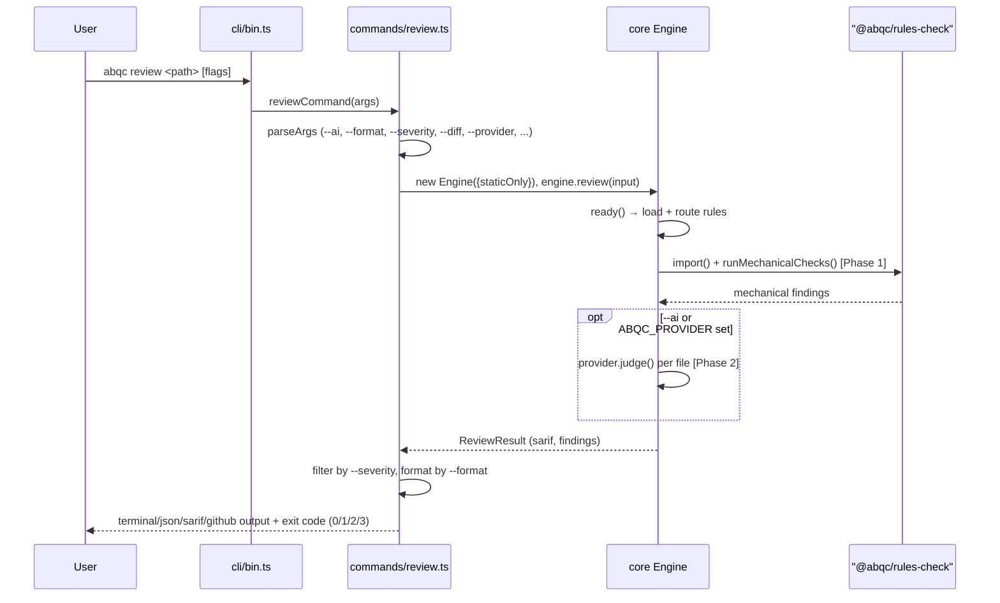
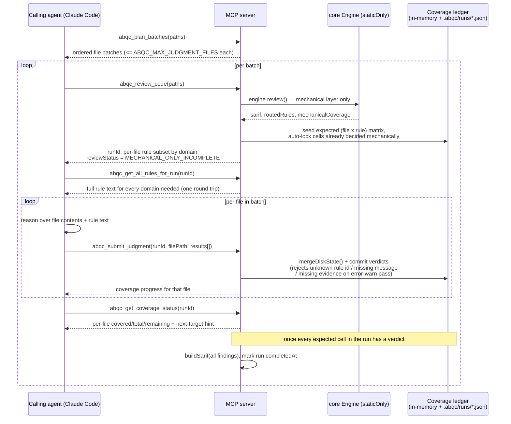

# appbuilder-quality-check

Code-quality review tooling for Adobe App Builder projects. Built on a 385-rule library (`rules/`) covering App Builder, Node.js, React, TypeScript, security, testing, deployment, and accessibility — with two product-specific sub-domains (API Mesh, Commerce Admin UI SDK) nested under App Builder.

## Architecture

One engine, five delivery channels:

```
packages/core/         ← engine: rule loader/router + walk + LLM judge + SARIF emitter
        │
        ├── packages/cli/         ← `abqc review` (mechanical + ESLint + optional --ai)
        ├── packages/rules-check/ ← declarative `### Check` specs + ESLint dedup (also wired into review)
        ├── packages/mcp/         ← MCP server for Claude Code / Cursor / Claude Desktop
        ├── packages/action/      ← GitHub Action (v0.2)
        └── packages/aio-plugin/  ← `aio app review` (v0.2)
```

Rules live at `rules/` and version with the engine. The engine emits SARIF 2.1.0; each channel re-formats SARIF for its target consumer (terminal, MCP tool response, GitHub PR comment, aio banner).

`packages/core` exposes an `Engine` class (`new Engine(options)` → `await engine.ready()` → `await engine.review(input)`), not a bare function — `ready()` is idempotent and only needs to run once per process, which is why the MCP server constructs a single `Engine` at startup and reuses it across every tool call.

## How a review runs

Every channel (CLI, MCP, rules-check) ultimately drives the same two-phase engine pipeline:



Two details matter for how the channels differ:

- The **CLI** sets `staticOnly: !aiEnabled` — Phase 2 runs in-process via an LLM provider (`anthropic`/`openai`/`claude-cli`/`stub`) only when `--ai`/`--provider`/`ABQC_PROVIDER` is set.
- The **MCP server** always constructs `Engine({ staticOnly: true })` — Phase 2 never runs inside the engine. Instead, `abqc_review_code` returns the mechanical SARIF plus the per-file applicable-rule subset, and the *calling agent* performs judgment via `abqc_submit_judgment`, tracked by a coverage ledger (see below).

### CLI sequence (`abqc review`)



### MCP judgment workflow (`abqc_review_code` → `abqc_submit_judgment`)

The MCP server can't call an LLM itself, so it hands the judgment layer to whichever agent is calling it — but it still owns the (file × rule) coverage matrix, so the agent can't silently skip a rule. This ledger-driven handoff is the part of the system with no CLI equivalent:



Runs expire out of the ledger after 30 minutes if incomplete (`RUN_TTL_MS`), or 5 minutes after completion (`COMPLETED_GRACE_MS`) — kept just long enough for a trailing coverage/status call to still resolve.

## Quick start

### CLI

```bash
cd appbuilder_quality_check
npm install                                                              # install workspace dependencies
npm run build                                                            # compile all packages to dist/
node packages/cli/dist/bin.js review /path/to/your/app-builder-app       # review an app (mechanical + ESLint, no LLM)
node packages/cli/dist/bin.js rules validate                             # validate every ### Check YAML spec
```

`abqc review` runs **Phase 1** (declarative mechanical checks + ESLint via `@abqc/rules-check`) by default. Use `--no-mechanical` for ESLint-only legacy mode, or `--ai` for LLM judgment on markdown rules.

### MCP server (Claude Code)

Add to your `.mcp.json`:

```json
{
  "mcpServers": {
    "appbuilder-qc": {
      "command": "node",
      "args": ["/absolute/path/to/appbuilder_quality_check/packages/mcp/dist/server.js"],
      "env": {
        "ABQC_PROJECT_ROOT": "/absolute/path/to/the-app-builder-repo-being-reviewed"
      }
    }
  }
}
```

Set `ABQC_PROJECT_ROOT` (or `MCP_ABQC_PROJECT_ROOT`) to the repo root when the MCP host spawns the process from a different cwd (common in Cursor). Reviews are scoped to that directory.

Restart Claude Code; all 8 `abqc_*` tools appear (see the [MCP server tools](#mcp-server-tools-packagesmcpdistserverjs) reference below), led by `abqc_review_code`.

### Mechanical rules-check (no AI)

Run deterministic checks with **zero LLM calls**. Two layers run together:

- **Declarative checkers** — rules with a `### Check` YAML block in `rules/` are dispatched by check type (`regex`, `yaml-path`, `builtin`) via a checker registry (acqc-style).
- **ESLint layer** — the same deterministic ESLint ruleset used by `@abqc/core`, with findings mapped to library rule ids and de-duplicated against mechanical hits on the same line.

```bash
node packages/rules-check/dist/bin.js check /path/to/your-app-builder-app   # run mechanical + ESLint checks on the whole app
node packages/rules-check/dist/bin.js check ./actions --severity=error       # report errors only (skip warn/info)
node packages/rules-check/dist/bin.js check ./actions --no-eslint            # declarative ### Check checkers only (skip ESLint)
node packages/rules-check/dist/bin.js check ./actions --format=sarif         # emit SARIF 2.1.0 JSON (for CI / code scanning)
node packages/rules-check/dist/bin.js coverage                               # regenerate the rule coverage report → packages/rules-check/COVERAGE.md
```

To add a new automatable rule, see [packages/rules-check/ADDING-RULES.md](./packages/rules-check/ADDING-RULES.md).

Findings are tagged by source (`[rules]` vs `[eslint]`). For large repos, pass specific
paths (e.g. `./actions`) — the walker caps at 2000 files. Rules that need semantic judgment
(idempotency, IDOR, tenant isolation, most a11y/react semantics) are tagged `manual` in
`COVERAGE.md` and require `abqc review --ai`.

## Command reference

All commands take one or more file/directory `<path>` arguments. Flags accept both
`--flag=value` and `--flag value` forms. Exit codes are shared: **0** clean · **1** warn-only
findings · **2** error findings (or usage error) · **3** engine/internal error.

### `abqc` — full review CLI (`packages/cli/dist/bin.js`)

| Command                     | Description                                                                                                           |
| --------------------------- | --------------------------------------------------------------------------------------------------------------------- |
| `abqc review <path...>`   | Review files/dirs. Runs the mechanical (declarative`### Check`) + ESLint layers by default; no LLM unless `--ai`. |
| `abqc rules list`         | List all loaded rules.                                                                                                |
| `abqc rules get <ruleId>` | Print one rule's full text (rationale + Bad + Good).                                                                  |
| `abqc rules validate`     | Validate every`### Check` YAML spec; reports automatable rule count.                                                |
| `abqc --version` / `-V` | Print version.                                                                                                        |
| `abqc --help` / `-h`    | Show help.                                                                                                            |

**`abqc review` flags**

| Flag                                   | Values / default                                              | Description                                                                             |
| -------------------------------------- | ------------------------------------------------------------- | --------------------------------------------------------------------------------------- |
| `--ai`, `--llm`                    | off                                                           | Enable the LLM judgment layer (needs a provider / API key).                             |
| `--provider=<p>`                     | `claude-cli` \| `anthropic` \| `openai` \| `stub`     | Pick the LLM provider; implies`--ai`.                                                 |
| `--static-only`                      | —                                                            | Force-disable the LLM layer even if a provider env var is set.                          |
| `--mechanical` / `--no-mechanical` | on                                                            | Toggle the declarative mechanical checks.`--no-mechanical` = ESLint-only legacy mode. |
| `--no-eslint`                        | ESLint on                                                     | Skip the ESLint layer inside the mechanical phase (declarative checkers only).          |
| `--diff=<ref>`                       | —                                                            | Only review files changed vs a git ref (e.g.`main`, `HEAD~1`).                      |
| `--format=<fmt>`                     | `terminal` (default) \| `json` \| `sarif` \| `github` | Output format.                                                                          |
| `--severity=<lvl>`                   | `info` (default) \| `warn` \| `error`                   | Minimum severity to report.                                                             |

**`abqc rules list` flags**

| Flag                  | Values                                      | Description                            |
| --------------------- | ------------------------------------------- | -------------------------------------- |
| `--domain=<d>`      | e.g.`appbuilder`, `security`, `react` | Filter by exact domain.                |
| `--severity=<lvl>`  | `error` \| `warn` \| `info`           | Filter by severity.                    |
| `-v`, `--verbose` | —                                          | Also print each rule's title and tags. |

### `abqc-rules-check` — mechanical-only checker (`packages/rules-check/dist/bin.js`)

Deterministic checks with **zero LLM calls** (declarative `### Check` + ESLint).

| Command                                     | Description                                                                       |
| ------------------------------------------- | --------------------------------------------------------------------------------- |
| `abqc-rules-check check <path...>`        | Run mechanical + ESLint (non-AI) checks.                                          |
| `abqc-rules-check coverage [--out=PATH]`  | Write the rule coverage report (defaults to`packages/rules-check/COVERAGE.md`). |
| `abqc-rules-check --version` / `--help` | Version / help.                                                                   |

**`check` flags**

| Flag                           | Values / default                                | Description                                                  |
| ------------------------------ | ----------------------------------------------- | ------------------------------------------------------------ |
| `--format=<fmt>`             | `terminal` (default) \| `json` \| `sarif` | Output format.                                               |
| `--severity=<lvl>`           | `info` (default) \| `warn` \| `error`     | Minimum severity to report.                                  |
| `--cwd=<dir>`                | `process.cwd()`                               | Project root used for relative paths and repo-scoped checks. |
| `--eslint` / `--no-eslint` | ESLint on                                       | Toggle the deterministic ESLint layer.                       |

### MCP server tools (`packages/mcp/dist/server.js`)

8 tools total, split between one-shot lookups and the run-scoped judgment workflow (see the [sequence diagram above](#mcp-judgment-workflow-abqc_review_code--abqc_submit_judgment)):

| Tool                           | Params                                                                                                                                         | Description                                                                                                                                                                                                                                                                                                                                                                                                                                                                                                                                                                                                  |
| ------------------------------ | ---------------------------------------------------------------------------------------------------------------------------------------------- | ------------------------------------------------------------------------------------------------------------------------------------------------------------------------------------------------------------------------------------------------------------------------------------------------------------------------------------------------------------------------------------------------------------------------------------------------------------------------------------------------------------------------------------------------------------------------------------------------------------ |
| `abqc_plan_batches`          | `paths: string[]` (required), `diff?: string`                                                                                              | No ledger created. Splits a large path set into ordered batches of at most`ABQC_MAX_JUDGMENT_FILES` files each, for repeated `abqc_review_code` calls.                                                                                                                                                                                                                                                                                                                                                                                                                                                   |
| `abqc_review_code`           | `paths: string[]` (required, capped at `ABQC_MAX_JUDGMENT_FILES` — refused above that), `diff?: string`, `include_contents?: boolean` | Runs both deterministic (mechanical) layers, seeds a new coverage-ledger`runId`, and returns SARIF findings plus the applicable rule subset per file. `reviewStatus` is always `MECHANICAL_ONLY_INCOMPLETE` — judgment-layer verdicts are still owed.                                                                                                                                                                                                                                                                                                                                                 |
| `abqc_get_all_rules_for_run` | `runId: string` (required)                                                                                                                   | Fetches full rule text (rationale + Bad + Good) for every domain the run needs, in one round trip — meant to be called once per run before submitting any verdicts.                                                                                                                                                                                                                                                                                                                                                                                                                                         |
| `abqc_get_rules_for_domain`  | `domain?: string`, `filePath?: string`, `runId?: string`                                                                                 | Paginated (≤50 rules/page) fetch of one domain's rule text; usable library-wide (omit`runId`/`filePath`) or scoped to a run.                                                                                                                                                                                                                                                                                                                                                                                                                                                                            |
| `abqc_submit_judgment`       | `runId: string`, `filePath: string`, `results?: array` or `resultsPath?: string` (exactly one)                                         | Submits judgment verdicts (`pass`/`violation`) for one file's remaining rules. Rejects unknown/duplicate rule ids, violations missing `message`, or error/warn passes with unacceptable `evidence`: too short/generic, a known templated-fallback phrase (e.g. "no pattern matching \<rule\>"), pure restatement of the rule's own title/rationale, or — when the file is readable — evidence that cites nothing actually present in the file's source (license/copyright-header words like "Adobe" or "Copyright" don't count, since they appear in nearly every file regardless of its content). |
| `abqc_get_coverage_status`   | `runId: string` (required)                                                                                                                   | Read-only progress check: per-file covered/total/remaining rule counts and a suggested next target.                                                                                                                                                                                                                                                                                                                                                                                                                                                                                                          |
| `abqc_list_rules`            | `domain?: string`, `severity?: "error"\|"warn"\|"info"`                                                                                      | List rules (domain prefix match, e.g.`appbuilder/api-mesh`); bypasses the ledger entirely.                                                                                                                                                                                                                                                                                                                                                                                                                                                                                                                 |
| `abqc_get_rule`              | `id: string` (required)                                                                                                                      | Fetch one rule's full JSON (rationale + Bad + Good); bypasses the ledger entirely.                                                                                                                                                                                                                                                                                                                                                                                                                                                                                                                           |

A run's SARIF (from judgment findings) is only emitted once every file in the run has a verdict for every applicable rule — `abqc_get_coverage_status` is how the agent checks whether it's done.

### MCP prompts

| Prompt                     | Args                                               | Description                                                                                                                                                                                                                                                                                                                                                                                                      |
| -------------------------- | -------------------------------------------------- | ---------------------------------------------------------------------------------------------------------------------------------------------------------------------------------------------------------------------------------------------------------------------------------------------------------------------------------------------------------------------------------------------------------------- |
| `review_code_completely` | `target?: string` (defaults to the project root) | Returns the full review→judgment→coverage-check workflow as one instruction, so a calling client can invoke it directly (e.g. as a slash command) instead of the workflow discipline having to be re-written into every client's own rules/system-prompt file. Coverage is still enforced server-side by the ledger regardless of whether this prompt is used — it only changes what the agent is told to do. |

Clients without prompt support (varies by Cursor version) can paste the equivalent instructions into a project-level rules file instead; see the prompt's returned text for the exact wording to mirror.

### Environment variables

| Variable                                          | Used by | Purpose                                                                                                                                                                                                    |
| ------------------------------------------------- | ------- | ---------------------------------------------------------------------------------------------------------------------------------------------------------------------------------------------------------- |
| `ABQC_PROVIDER`                                 | CLI     | `anthropic` \| `openai` \| `claude-cli` \| `stub` — enables the LLM layer and picks the provider.                                                                                                 |
| `ABQC_MODEL`                                    | CLI     | Model override for Anthropic / Claude-CLI (e.g.`claude-sonnet-4-6`).                                                                                                                                     |
| `ANTHROPIC_API_KEY`                             | CLI     | Enables the Anthropic provider automatically.                                                                                                                                                              |
| `OPENAI_API_KEY`                                | CLI     | Enables the OpenAI provider automatically.                                                                                                                                                                 |
| `ABQC_PROJECT_ROOT` / `MCP_ABQC_PROJECT_ROOT` | MCP     | Repo root to scope reviews to when the host cwd differs.                                                                                                                                                   |
| `ABQC_RULES_DIR` / `MCP_ABQC_RULES_DIR`       | core    | Override the rules directory (deploying outside the monorepo).                                                                                                                                             |
| `ABQC_MAX_JUDGMENT_FILES`                       | MCP     | Max files per`abqc_review_code` call (default `3`). Enforced, not advisory — a mechanical-only SARIF for a large file set tends to get reported as a finished review with the judgment layer skipped. |

## Rule library

385 rules across 13 top-level domains, ~95 sub-files. See [rules/README.md](./rules/README.md) for the full catalog.

## Status

v0.1: `core` + `cli` + `mcp` + `rules-check` (mechanical judgment checker).
v0.2: `action` + `aio-plugin`.
